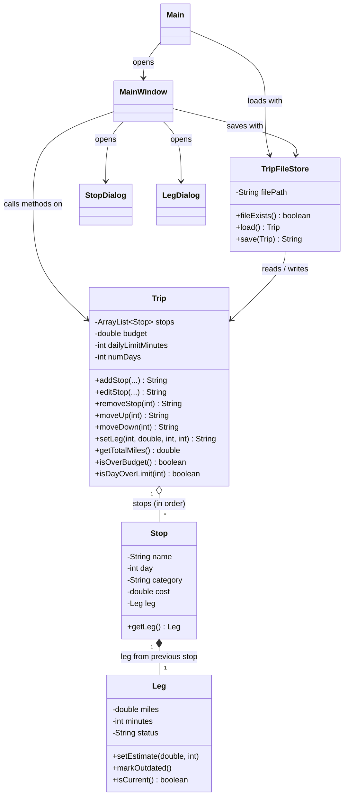

# Class Design (Data Design)
<!-- Keep this TRUE as the code changes: Claude reads it before every feature. -->

## Big picture
`Trip` is the **manager**: it owns the `ArrayList<Stop>`, the budget, the daily drive limit, and the number of days,
and it checks **every rule**. Each `Stop` holds one `Leg` (the drive *from the previous stop to this stop*).
The Swing UI (`MainWindow`, `StopDialog`, `LegDialog`) never changes the list itself. It calls a `Trip` method,
and the method returns a `String`: `""` means it worked, anything else is the error message to show (D11).
`TripFileStore` saves and loads the trip as plain text in `data/trip.txt`.

## Class diagram


## Classes

### `Leg` (model)
**Responsibility:** The drive to one stop from the stop before it: miles, minutes, and whether those numbers can be trusted.

| Fields (all private) | Type | Meaning |
|---|---|---|
| `miles` | `double` | Distance in miles (≥ 0) |
| `minutes` | `int` | Drive time in whole minutes (≥ 0) |
| `status` | `String` | `CURRENT`, `OUTDATED`, or `MISSING` |

Constants: `public static final String CURRENT = "Current"`, `OUTDATED = "Outdated"`, `MISSING = "Missing"`.

| Method | Purpose |
|---|---|
| `Leg()` constructor | New leg: 0 miles, 0 minutes, `MISSING` |
| `Leg(double miles, int minutes, String status)` constructor | Rebuild a leg when loading the file |
| `getMiles()`, `getMinutes()`, `getStatus()` | Getters |
| `setEstimate(double miles, int minutes)` | Store new numbers and set status to `CURRENT` (`Trip.setLeg` validates first) |
| `markOutdated()` | `CURRENT` → `OUTDATED`. `MISSING` and `OUTDATED` stay as they are |
| `isCurrent()` | `true` if the numbers count toward totals |
| `toString()` | e.g. `"95.0 mi, 1h 45m (Current)"` or `"— (Missing)"` |

**CSC110 concepts shown:** private fields, two constructors (overloading), `String` constants, `if/else`, `toString`.

### `Stop` (model)
**Responsibility:** One place on the trip (name, day, category, cost) plus the leg that drives you there.

| Fields (all private) | Type | Meaning |
|---|---|---|
| `name` | `String` | Unique, not blank, no `\|` |
| `day` | `int` | 1 to the trip's number of days |
| `category` | `String` | One of the category constants |
| `cost` | `double` | Activity cost in dollars (≥ 0) |
| `leg` | `Leg` | Drive from the previous stop (ignored if this is the first stop) |

Constants: `FOOD = "Food"`, `SIGHTSEEING = "Sightseeing"`, `LODGING = "Lodging"`, `ACTIVITY = "Activity"`, `OTHER = "Other"`,
and `public static final String[] CATEGORIES` holding all five (used to fill the dropdown and to validate).

| Method | Purpose |
|---|---|
| `Stop(String name, int day, String category, double cost)` constructor | New stop with a new `MISSING` leg |
| `Stop(String name, int day, String category, double cost, Leg leg)` constructor | Rebuild a stop when loading |
| `getName()`, `getDay()`, `getCategory()`, `getCost()`, `getLeg()` | Getters |
| `static isValidCategory(String category)` | `true` if it's in `CATEGORIES` (loop over the array). `static` = you call it on the class, `Stop.isValidCategory(...)`, no object needed |
| `toString()` | e.g. `"Day 2 · Santa Barbara (Sightseeing) $25.00"` |

No setters: to edit a stop, `Trip.editStop` replaces it with a new `Stop` that keeps the old `Leg`. That way nothing can change a stop without going through the rules.

**CSC110 concepts shown:** an object holding another object (`Stop` has a `Leg`), arrays, getters, constants, `toString`.

### `Trip` (manager)
**Responsibility:** Owns the ordered list of stops and the trip settings, and enforces every rule (validation, leg status, totals).

| Fields (all private) | Type | Meaning |
|---|---|---|
| `stops` | `ArrayList<Stop>` | Stops in trip order |
| `budget` | `double` | Dollars (≥ 0) |
| `dailyLimitMinutes` | `int` | Max drive minutes per day (> 0) |
| `numDays` | `int` | Number of days in the trip (≥ 1) |

| Method | Purpose |
|---|---|
| `Trip()` constructor | Empty trip: budget $0, limit 480 min (8h), 7 days |
| `Trip(double budget, int dailyLimitMinutes, int numDays)` constructor | Used when loading |
| `getBudget()`, `getDailyLimitMinutes()`, `getNumDays()`, `getStopCount()`, `getStop(int index)` | Read-only access (the list itself is never handed out) |
| `setBudget(double)` → `String` | Reject < 0 |
| `setDailyLimit(int minutes)` → `String` | Reject ≤ 0 |
| `setNumDays(int)` → `String` | Reject < 1, or fewer days than a stop uses (D14) |
| `addStop(String name, int day, String category, double cost)` → `String` | Validate, then insert **after the last stop with the same or an earlier day** (D16). Marks the *next* stop's leg outdated |
| `editStop(int index, String name, int day, String category, double cost)` → `String` | Validate (name check skips this stop; day must fit between neighbours), then `stops.set(index, new Stop(..., oldStop.getLeg()))`. Leg status unchanged (D8) |
| `removeStop(int index)` → `String` | Remove; marks the stop that moves up into its place outdated |
| `moveUp(int index)` / `moveDown(int index)` → `String` | Swap with the neighbour. Rejected for the top stop (up) / bottom stop (down), and unless both stops have the **same day** (D6). Marks the swapped stops and the stop after them outdated |
| `setLeg(int index, double miles, int hours, int minutes)` → `String` | Reject bad index, first stop, negatives, minutes over 59 (D17); then `leg.setEstimate(miles, hours * 60 + minutes)` |
| `addLoadedStop(Stop stop)` | Append as-is while loading (no outdating) |
| `getTotalMiles()`, `getTotalMinutes()` | Add up CURRENT legs, skipping the first stop |
| `getPlannedCost()`, `getRemainingBudget()`, `isOverBudget()` | Cost totals; over = cost **>** budget |
| `getDayMinutes(int day)`, `isDayOverLimit(int day)` | Drive minutes arriving on that day; over = **>** limit (D1, D4) |
| `countOutdatedLegs()`, `countMissingLegs()`, `isIncomplete()` | For the "⚠ Incomplete" warning (first stop skipped) |
| `getMatchingStops(String nameText, int day, String category)` → `ArrayList<Stop>` | Search + filter. `""` = any name, `0` = any day, `""` = any category. Name match ignores capitals |
| `getIndexOf(Stop stop)` → `int` | Position of a stop in the full list (loop; `-1` if not found). Lets the UI edit a stop picked from a filtered list |
| private `validateStop(name, day, category, cost, skipIndex)` → `String` | Shared checks for add and edit |
| private `isNameTaken(String name, int skipIndex)` | Duplicate check ignoring capitals |
| private `markOutdated(int index)` | Safe helper: does nothing if the index is out of range |

**CSC110 concepts shown:** `ArrayList` (add at index, remove, set, get), for loops with accumulators (totals), methods returning values, private helper methods, validation with `if/else`, `String` methods (`trim`, `toLowerCase`, `contains`, `equalsIgnoreCase`).

### `TripFileStore` (file store)
**Responsibility:** Turns a `Trip` into lines of text in a file, and back again.

| Fields (all private) | Type | Meaning |
|---|---|---|
| `filePath` | `String` | Usually `"data/trip.txt"` (tests use a test file) |

| Method | Purpose |
|---|---|
| `TripFileStore(String filePath)` constructor | Remember which file to use |
| `fileExists()` | `true` if the file is there (so `Main` can show a friendly message if not) |
| `load()` → `Trip` | Read `TRIP` line, then each `STOP` line via `trip.addLoadedStop(...)`. Skips lines it can't read |
| `save(Trip trip)` → `String` | Write every line; `""` on success, otherwise an error message |
| private `stopToLine(Stop)` / `lineToStop(String)` | Convert one stop to/from one line using `split("\\|")` (BEYOND CSC110: the `\\` is needed because `split` treats `\|` as a special symbol) |

**CSC110 concepts shown:** loops, `String.split`, `Integer.parseInt` / `Double.parseDouble`. BEYOND CSC110: file reading/writing and `try/catch`.

### UI classes (BEYOND CSC110: Swing)
| Class | Responsibility |
|---|---|
| `Main` | Entry point: makes a `TripFileStore`, loads the trip (or a new empty `Trip` plus a message), opens `MainWindow` |
| `MainWindow` (extends `JFrame`) | Stop list with each leg's status, Add/Edit/Remove/Move Up/Move Down/Edit Leg/Save buttons, search box + day/category filters, trip settings, and the summary area (totals, remaining budget, over-budget, over-limit days, ⚠ Incomplete) |
| `StopDialog` | Pop-up form for adding/editing a stop (category from a dropdown filled from `Stop.CATEGORIES`) |
| `LegDialog` | Pop-up form for miles + hours + minutes |

Totals are **never stored** in fields; `Trip` adds them up fresh every time the screen refreshes. That is how "changing a stop updates the rest of the plan" stays true automatically.

UI rule: read the fields, call the `Trip` method, and if the returned `String` isn't `""`, show it in a message box. Then refresh the screen.

## Where the rules live
| Rule | Class.method |
|---|---|
| Budget ≥ 0 | `Trip.setBudget` |
| Daily limit > 0 minutes | `Trip.setDailyLimit` |
| Days ≥ 1 and can't drop below a stop's day | `Trip.setNumDays` |
| Name not blank, no `\|`, unique (ignoring capitals) | `Trip.validateStop` / `Trip.isNameTaken` |
| Day 1..numDays; cost ≥ 0; category in the list | `Trip.validateStop` (uses `Stop.isValidCategory`) |
| Days never go backwards (add places it; edit checks neighbours; move needs same day) | `Trip.addStop`, `Trip.editStop`, `Trip.moveUp/moveDown` |
| New stop's leg starts MISSING | `Leg()` constructor |
| Add/remove/reorder makes affected legs OUTDATED | `Trip.addStop/removeStop/moveUp/moveDown` → `Leg.markOutdated` |
| Editing name/cost/category/day doesn't outdate a leg | `Trip.editStop` (doesn't touch the leg) |
| Leg: stop must exist and not be first; miles/hours ≥ 0; minutes 0–59 (D17) | `Trip.setLeg` |
| First stop's leg ignored | `Trip` totals and counts start at index 1 |
| Totals count only CURRENT legs | `Trip.getTotalMiles/getTotalMinutes/getDayMinutes` |
| Over budget = cost > budget | `Trip.isOverBudget` |
| Day over limit = minutes > limit | `Trip.isDayOverLimit` |
| Incomplete warning | `Trip.countOutdatedLegs/countMissingLegs/isIncomplete` |
| Missing file → empty trip, no crash | `Main` + `TripFileStore.fileExists` |

## Save file format
File: `data/trip.txt`. One record per line, fields separated by `|`. The first line is the trip settings,
then one `STOP` line per stop **in trip order**. Leg values are saved even when OUTDATED, so old numbers come back.
```
TRIP|budget|dailyLimitMinutes|numDays
STOP|name|day|category|cost|legMiles|legMinutes|legStatus
```
Example:
```
TRIP|1500.0|360|7
STOP|San Diego|1|Lodging|0.0|0.0|0|Missing
STOP|Los Angeles|1|Sightseeing|45.0|120.0|130|Current
STOP|San Francisco|3|Food|60.0|380.0|360|Outdated
```
